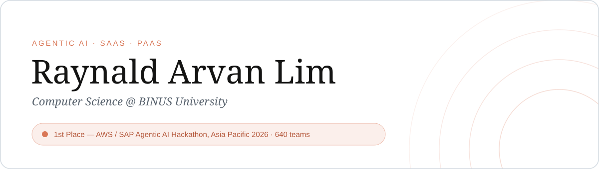
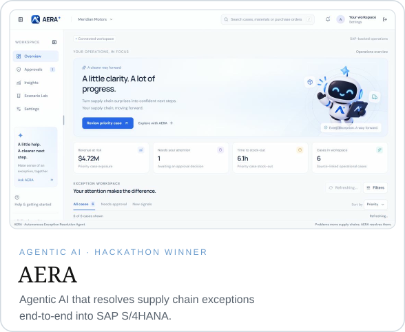
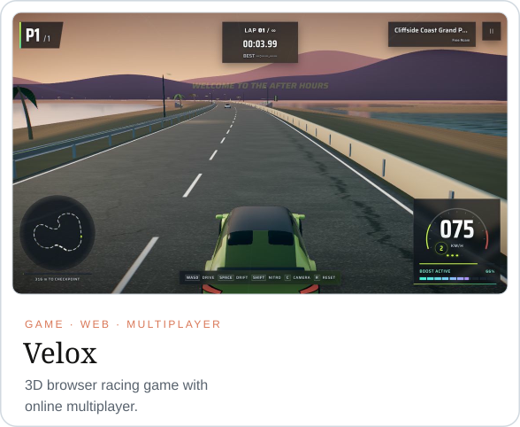
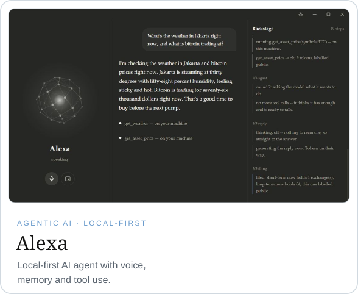
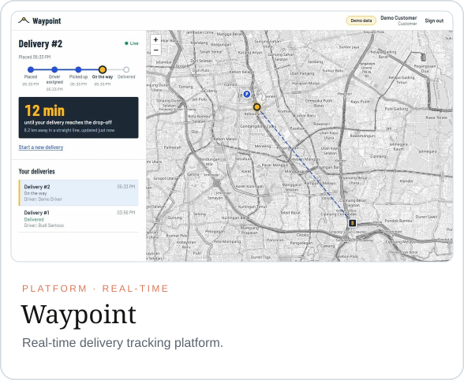

<div align="center">

<picture><source media="(prefers-color-scheme: dark)" srcset="assets/header-dark.svg"><source media="(prefers-color-scheme: light)" srcset="assets/header-light.svg"></picture>

<picture><source media="(prefers-color-scheme: dark)" srcset="assets/currently-dark.svg"><source media="(prefers-color-scheme: light)" srcset="assets/currently-light.svg"></picture>


<a href="https://github.com/aera-scm/aera-be"><picture><source media="(prefers-color-scheme: dark)" srcset="assets/aera-dark.svg"><source media="(prefers-color-scheme: light)" srcset="assets/aera-light.svg"></picture></a>
<a href="https://github.com/DlegendZ/Velox"><picture><source media="(prefers-color-scheme: dark)" srcset="assets/velox-dark.svg"><source media="(prefers-color-scheme: light)" srcset="assets/velox-light.svg"></picture></a>
<a href="https://github.com/DlegendZ/Alexa"><picture><source media="(prefers-color-scheme: dark)" srcset="assets/alexa-dark.svg"><source media="(prefers-color-scheme: light)" srcset="assets/alexa-light.svg"></picture></a>
<a href="https://github.com/DlegendZ/Waypoint"><picture><source media="(prefers-color-scheme: dark)" srcset="assets/waypoint-dark.svg"><source media="(prefers-color-scheme: light)" srcset="assets/waypoint-light.svg"></picture></a>


</div>

<!--START_SECTION:waka-->

```text
From: 29 January 2026 - To: 30 October 2026

Total Time: 214 hrs 41 mins

Python            62 hrs 57 mins        ⣿⣿⣿⣿⣿⣿⣿⣀⣀⣀⣀⣀⣀⣀⣀⣀⣀⣀⣀⣀⣀⣀⣀⣀⣀   27.85 %
Java              47 hrs 11 mins        ⣿⣿⣿⣿⣿⣄⣀⣀⣀⣀⣀⣀⣀⣀⣀⣀⣀⣀⣀⣀⣀⣀⣀⣀⣀   20.88 %
TypeScript        21 hrs 24 mins        ⣿⣿⣤⣀⣀⣀⣀⣀⣀⣀⣀⣀⣀⣀⣀⣀⣀⣀⣀⣀⣀⣀⣀⣀⣀   09.47 %
JavaScript        9 hrs 31 mins         ⣿⣀⣀⣀⣀⣀⣀⣀⣀⣀⣀⣀⣀⣀⣀⣀⣀⣀⣀⣀⣀⣀⣀⣀⣀   04.22 %
HTML              8 hrs 13 mins         ⣷⣀⣀⣀⣀⣀⣀⣀⣀⣀⣀⣀⣀⣀⣀⣀⣀⣀⣀⣀⣀⣀⣀⣀⣀   03.64 %
JSON              7 hrs 14 mins         ⣷⣀⣀⣀⣀⣀⣀⣀⣀⣀⣀⣀⣀⣀⣀⣀⣀⣀⣀⣀⣀⣀⣀⣀⣀   03.20 %
```

<!--END_SECTION:waka-->
