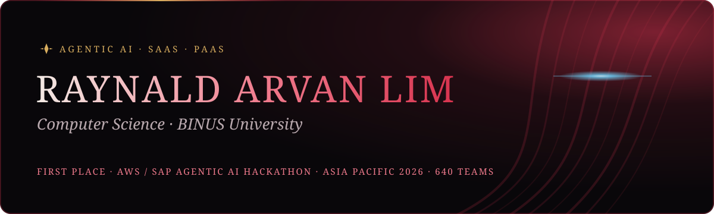
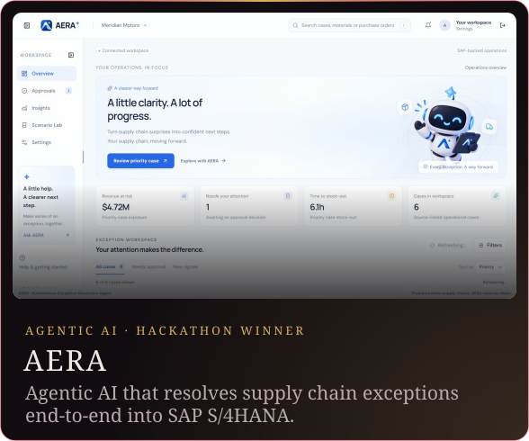
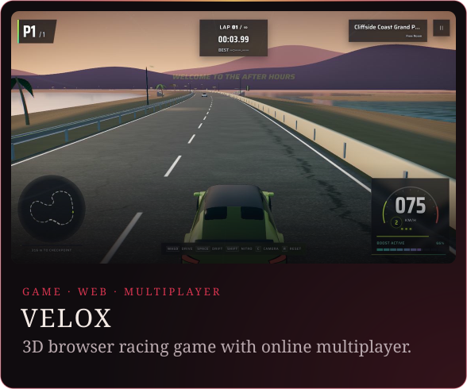
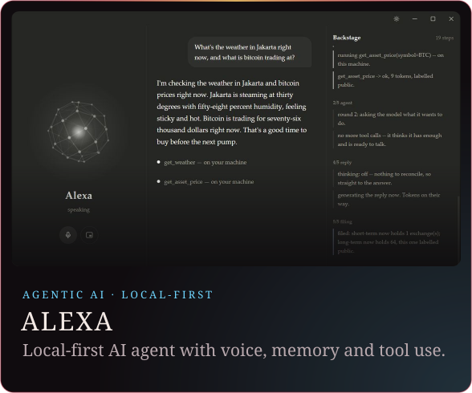
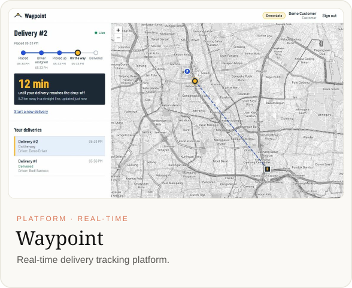

<div align="center">



<br><br>


<br><br>


<a href="https://github.com/aera-scm/aera-be"></a>
<a href="https://github.com/DlegendZ/Velox"></a>
<a href="https://github.com/DlegendZ/Alexa"></a>
<a href="https://github.com/DlegendZ/Waypoint"></a>

<br><br>


</div>

<!--START_SECTION:waka-->

```text
From: 29 January 2026 - To: 30 October 2026

Total Time: 214 hrs 41 mins

Python            62 hrs 57 mins        ⣿⣿⣿⣿⣿⣿⣿⣀⣀⣀⣀⣀⣀⣀⣀⣀⣀⣀⣀⣀⣀⣀⣀⣀⣀   27.85 %
Java              47 hrs 11 mins        ⣿⣿⣿⣿⣿⣄⣀⣀⣀⣀⣀⣀⣀⣀⣀⣀⣀⣀⣀⣀⣀⣀⣀⣀⣀   20.88 %
TypeScript        21 hrs 24 mins        ⣿⣿⣤⣀⣀⣀⣀⣀⣀⣀⣀⣀⣀⣀⣀⣀⣀⣀⣀⣀⣀⣀⣀⣀⣀   09.47 %
JavaScript        9 hrs 31 mins         ⣿⣀⣀⣀⣀⣀⣀⣀⣀⣀⣀⣀⣀⣀⣀⣀⣀⣀⣀⣀⣀⣀⣀⣀⣀   04.22 %
HTML              8 hrs 13 mins         ⣷⣀⣀⣀⣀⣀⣀⣀⣀⣀⣀⣀⣀⣀⣀⣀⣀⣀⣀⣀⣀⣀⣀⣀⣀   03.64 %
JSON              7 hrs 14 mins         ⣷⣀⣀⣀⣀⣀⣀⣀⣀⣀⣀⣀⣀⣀⣀⣀⣀⣀⣀⣀⣀⣀⣀⣀⣀   03.20 %
```

<!--END_SECTION:waka-->
